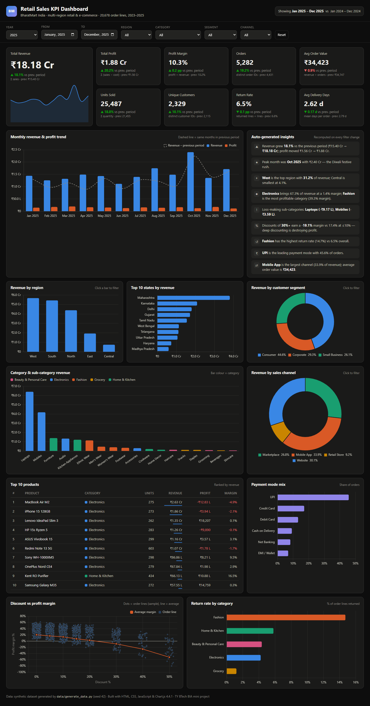
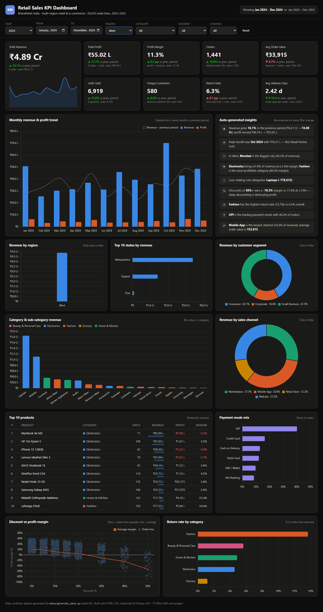
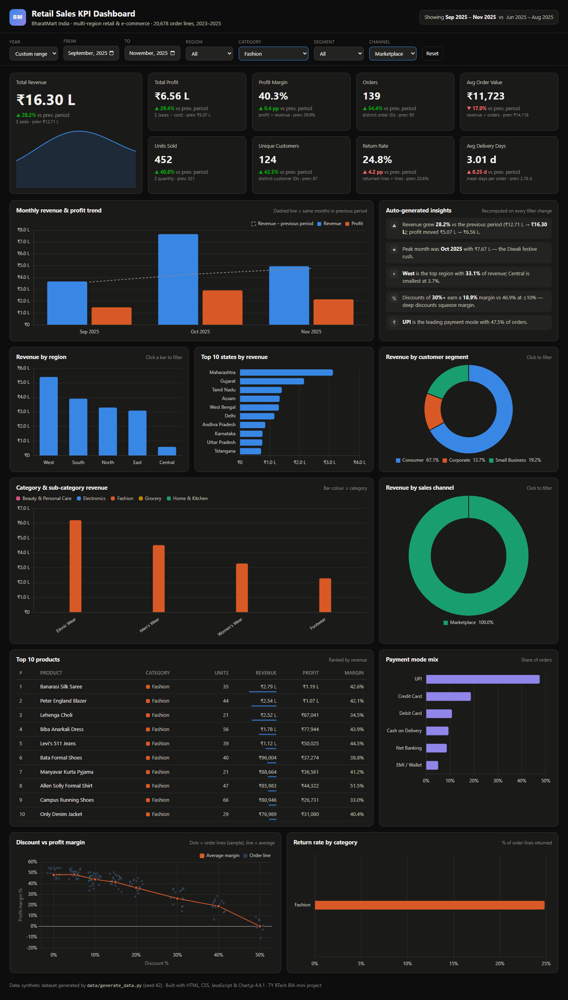
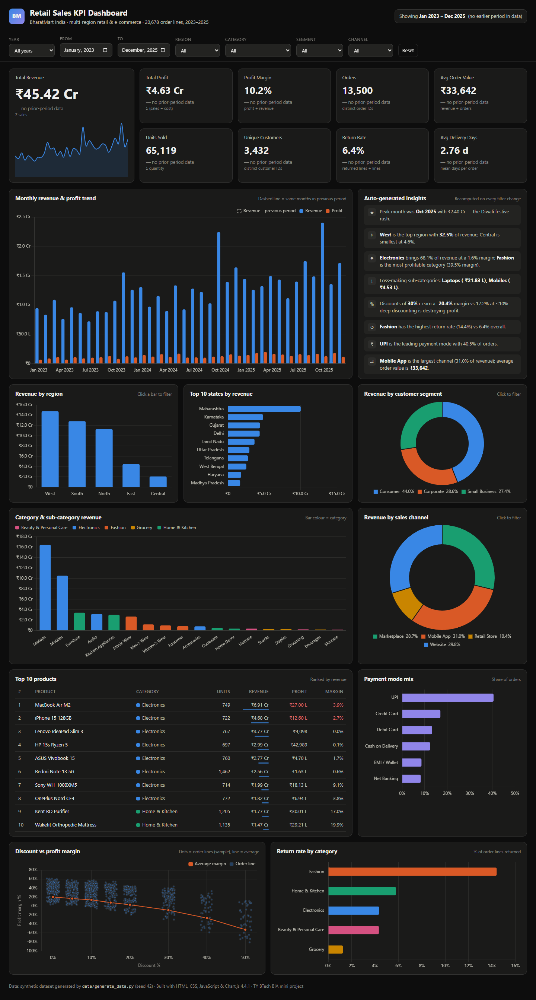

# Retail Sales KPI Dashboard

**Live dashboard:** https://chhelu123.github.io/retail-kpi-dashboard/  
**Source code:** https://github.com/chhelu123/retail-kpi-dashboard

*BIA (Business Intelligence & Analytics) mini project, TY BTech.*



---

## 1. Problem statement / description

A retail company that sells across India through a website, a mobile app, online
marketplaces and its own stores collects thousands of order records every month.
Raw order tables do not tell management **how the business is doing**. They need
answers to questions like these:

- How much revenue and profit did we make in a period, and is it growing?
- Which regions, states, categories and products drive the business?
- Are discounts helping or hurting profit?
- Which channels and payment modes do customers prefer?
- Are returns and delivery times under control?

This project builds an interactive **KPI dashboard**, a dynamic website, for a
fictional Indian multi-region retailer, *BharatMart*, covering **January 2023 to
December 2025**. The dashboard turns about 20,000 order lines into 9 KPI cards,
10 charts, a top-products table and auto-written insights. **Every number updates
live** when the user changes the global filters (date range / year, region,
category, segment, channel). The whole site is static (HTML + CSS + JavaScript),
so it needs no backend and is hosted free on GitHub Pages.

## 2. Dataset

> **The dataset is synthetic.** It was generated by `data/generate_data.py`
> (Python, NumPy, pandas, random seed 42). Popular public retail datasets such as
> the "Sample Superstore" are US-based (US states, US$, US holidays). This project
> needed **Indian** geography, ₹ prices and Indian festive seasonality, so a
> realistic generator was written instead. Re-running the script always produces
> the same data.

**Size:** 20,678 order lines · 13,500 orders · 3,432 customers · 26 cities in 20
states and 5 regions · 72 products in 5 categories / 18 sub-categories · 36
months.

**Realism built into the generator**

| Pattern | How it is modelled |
|---|---|
| Growth trend | Order volume grows about 20% a year, and prices inflate about 5% a year |
| Diwali spike | Demand rises up to 2.6x in the 3 weeks before the real Diwali date of each year (12 Nov 2023, 1 Nov 2024, 20 Oct 2025) |
| Other sales | Republic Day (Jan), Independence Day (Aug), year-end sale (Dec), FY-end corporate buying (Mar); monsoon dip (Jun–Jul) |
| Discounts | Deeper discounts in festive windows; Fashion and Beauty discount more; heavy discounts lead to losses |
| Payments | UPI share rises and Cash on Delivery falls over the 3 years |
| Logistics | Delivery days depend on region (East/Central slower) and improve over time |
| Returns | Higher for Fashion and the Marketplace channel, lower for Grocery and Retail Store |
| Customers | Each customer has a home city and segment; a Pareto distribution creates repeat buyers |

**Columns** (`data/orders.csv`, one row per order line)

| Column | Type | Description |
|---|---|---|
| order_date | date | Date of the order (2023-01-01 to 2025-12-31) |
| order_id | text | Order number, e.g. `BM-2025-012345` (an order can have 1–3 lines) |
| region | text | North, South, East, West, Central |
| state | text | Indian state, e.g. Maharashtra, Karnataka |
| city | text | City, e.g. Mumbai, Bengaluru |
| segment | text | Consumer, Corporate, Small Business |
| category | text | Electronics, Fashion, Home & Kitchen, Grocery, Beauty & Personal Care |
| sub_category | text | 18 sub-categories, e.g. Mobiles, Laptops, Ethnic Wear |
| product | text | Product name, e.g. Redmi Note 13 5G |
| quantity | int | Units in the line |
| unit_price | ₹ | List price per unit |
| discount | 0–0.5 | Discount fraction (0, 5, 10, 15, 20, 30, 40, 50%) |
| sales | ₹ | Revenue = quantity × unit_price × (1 − discount) |
| cost | ₹ | Cost of goods sold for the line |
| profit | ₹ | sales − cost (can be negative) |
| customer_id | text | Customer, e.g. `CUST-00042` |
| channel | text | Website, Mobile App, Marketplace, Retail Store |
| payment_mode | text | UPI, Credit Card, Debit Card, Net Banking, Cash on Delivery, EMI / Wallet |
| delivery_days | int | Days from order to delivery (order level) |
| returned | 0/1 | 1 if the line was returned |

For the website, the same data is also saved as `data/orders.json` (1.4 MB). In this
compact form, every text column is stored once in a lookup list and each row
keeps only small integer codes. That is about 2.6x smaller than the CSV.

## 3. KPIs and formulas

Every KPI is computed on the rows that match the current filters. Each card also
compares the value with the **previous period**: a window of the same length
immediately before the selected one. For example, 2025 is compared with 2024, and
Sep–Nov 2025 with Jun–Aug 2025. The card shows ▲ or ▼, coloured green if the
change is good and red if it is bad. For Return Rate and Delivery Days, lower is
better.

| KPI | Formula |
|---|---|
| Total Revenue | Σ sales |
| Total Profit | Σ (sales − cost) |
| Profit Margin % | Total Profit ÷ Total Revenue × 100 |
| Orders | count of distinct order_id |
| Average Order Value (AOV) | Total Revenue ÷ Orders |
| Units Sold | Σ quantity |
| Unique Customers | count of distinct customer_id |
| Return Rate % | returned lines ÷ total lines × 100 |
| Avg Delivery Days | mean of delivery_days over distinct orders |
| Change vs previous period | (current − previous) ÷ previous × 100; for % KPIs, the difference in percentage points (pp) |

All money is shown in the Indian system: `₹18.18 Cr`, `₹4.89 L`, `₹34,423`, and
counts use lakh grouping (`12,34,567`).

## 4. Dashboard features

- **Global filters:** year (or a custom From/To month range), region, category,
  segment and channel. A change to any filter recalculates every KPI, chart, the
  table and the insights at once. **Reset** returns to the default view.
- **Shareable filtered views:** the current filters are written to the URL, for
  example `index.html?year=2024&region=West` or
  `index.html?from=2025-09&to=2025-11&category=Fashion&channel=Marketplace`.
  Opening such a link restores the same view.
- **Click-to-filter:** clicking a region bar, a segment slice or a channel slice
  sets that filter. Clicking it again clears the filter.
- **9 KPI cards** with change vs the previous period, the formula and the previous
  value. The revenue card also has a sparkline.
- **Charts:**
  1. Monthly revenue and profit trend (bars), with previous-period revenue as a
     dashed line
  2. Revenue by region
  3. Top 10 states by revenue
  4. Revenue by customer segment (donut)
  5. Category and sub-category revenue (bars coloured by category)
  6. Revenue by sales channel (donut)
  7. Top 10 products table: units, revenue, profit, margin, with in-cell bars
  8. Payment mode mix (% of orders)
  9. Discount vs profit-margin scatter (sampled order lines + average-margin line)
  10. Return rate by category
- **Auto-generated insights panel:** short text findings, rewritten from the
  filtered data each time. It covers growth, peak month and its festival, top
  region or city, category share vs margin, loss-making sub-categories, the
  discount effect, returns, payments and the leading channel.
- **BI look:** dark theme, one fixed colour per entity (for example, Electronics
  is always blue), hover tooltips on every chart, and a responsive layout
  (desktop → tablet → phone).

## 5. Tech stack

| Layer | Tool |
|---|---|
| Data generation | Python 3, NumPy, pandas (`data/generate_data.py`) |
| Data format | CSV (full data) + compact JSON (loaded by the page) |
| Front end | HTML5, CSS3 (grid / flexbox, media queries), vanilla JavaScript (ES2020) |
| Charts | [Chart.js 4.4.1](https://www.chartjs.org/) from the cdnjs CDN |
| Hosting | GitHub Pages (static, no server code) |
| Report / screenshots | Headless Google Chrome (Playwright for the filtered screenshots) |

**Project structure**

```
retail-kpi-dashboard/
├── index.html              dashboard page
├── css/style.css           theme and responsive layout
├── js/format.js            ₹ lakh/crore number formatting
├── js/dashboard.js         data loading, filters, KPIs, charts, insights
├── data/generate_data.py   synthetic data generator
├── data/orders.csv         generated dataset (20,678 rows)
├── data/orders.json        compact copy used by the website
├── screenshots/            output screenshots
├── report/                 report.html + build script
└── REPORT.pdf              printable project report
```

## 6. How to run

```bash
# 1. (optional) regenerate the data
py data/generate_data.py

# 2. serve the folder (the page loads data/orders.json with fetch, so file:// will not work)
py -m http.server 8000

# 3. open http://localhost:8000 in a browser
```

Or open the live version: https://chhelu123.github.io/retail-kpi-dashboard/

## 7. Key code, with explanation

### 7.1 Data loading (`js/dashboard.js`)

```js
async function loadData() {
  const res = await fetch("data/orders.json");
  const j = await res.json();
  const ci = Object.fromEntries(j.cols.map((c, i) => [c, i]));   // column name -> index
  const start = new Date(j.meta.start + "T00:00:00Z");
  state.rows = j.rows.map(r => {
    const d = new Date(start.getTime() + r[ci.day] * 864e5);
    const o = { mi: (d.getUTCFullYear() - 2023) * 12 + d.getUTCMonth(),   // month index 0..35
                order: r[ci.order], customer: r[ci.customer] };
    for (const k of ["region", "state", "city", "segment", "category",
                     "sub_category", "product", "channel", "payment_mode"])
      o[k] = j.dims[k][r[ci[k]]];                                 // decode lookup code -> text
    o.qty = r[ci.quantity]; o.sales = r[ci.sales]; o.profit = r[ci.profit]; /* ... */
    return o;
  });
}
```

The JSON file is fetched once. Each compact row (an array of numbers) is decoded
into a normal object. Text values are looked up in the `dims` lists, and the date
is turned into a **month index** (Jan 2023 = 0 … Dec 2025 = 35). Comparing whole
numbers makes date-range filtering and monthly grouping very fast.

### 7.2 Filter logic and the previous period

```js
function readFilters() {
  let from = ymToMi($("fFrom").value), to = ymToMi($("fTo").value);
  const f = { from, to };
  for (const [dim, id] of Object.entries(FILTER_DIMS)) f[dim] = $(id).value;
  const len = to - from + 1;                 // previous period = same length, just before
  f.prevFrom = from - len; f.prevTo = from - 1;
  return f;
}

function filterRows(f, from, to) {
  return state.rows.filter(r =>
    r.mi >= from && r.mi <= to &&
    (f.region   === "All" || r.region   === f.region) &&
    (f.category === "All" || r.category === f.category) &&
    (f.segment  === "All" || r.segment  === f.segment) &&
    (f.channel  === "All" || r.channel  === f.channel));
}
```

Every filter control has a `change` listener that calls `render()`. `render()`
calls `filterRows` twice: once for the selected window and once for the
previous window, with the same dimension filters. The previous-period rows feed
the ▲/▼ comparisons and the dashed line on the trend chart.

### 7.3 KPI computation

```js
function computeKPIs(rows) {
  let revenue = 0, profit = 0, units = 0, returned = 0;
  const orders = new Map(), customers = new Set();
  for (const r of rows) {
    revenue += r.sales; profit += r.profit; units += r.qty; returned += r.returned;
    orders.set(r.order, r.days);            // delivery days are stored per order
    customers.add(r.customer);
  }
  let dsum = 0; for (const d of orders.values()) dsum += d;
  const n = orders.size;
  return { revenue, profit, units, orders: n, customers: customers.size,
           margin: profit / revenue, aov: revenue / n,
           returnRate: returned / rows.length, delivery: dsum / n };
}
```

One pass over the rows computes all nine KPIs. A `Set` counts distinct customers.
A `Map` counts distinct orders and keeps one delivery value per order, so an
order with 3 lines is not counted 3 times in Avg Delivery Days.

### 7.4 A chart: revenue by region (with click-to-filter)

```js
function renderRegion(rows) {
  const g = groupBy(rows, "region").sort((a, b) => b.sales - a.sales);
  upsert("cRegion", {
    type: "bar",
    data: { labels: g.map(x => x.key),
            datasets: [{ label: "Revenue", data: g.map(x => x.sales),
                         backgroundColor: SERIES[0], borderRadius: 4 }] },
    options: {
      plugins: { tooltip: { callbacks: { label: c => {
        const x = g[c.dataIndex];
        return [` Revenue: ${inr(x.sales)}`, ` Profit: ${inr(x.profit)} (${pct(x.profit / x.sales)})`];
      } } } },
      scales: { y: { ticks: { callback: v => inrAxis(v) } } },
      onClick: (e, els) => els.length && setFilter("region", g[els[0].index].key),
    },
  });
}
```

`groupBy` adds up sales and profit for each region. `upsert` creates the chart the
first time; on later calls it only swaps the data, so Chart.js animates the bars
to their new heights. The y-axis and tooltip use the `inr()` helper below.
`onClick` turns the chart into a filter.

### 7.5 Indian number formatting (`js/format.js`)

```js
function inr(v, digits = 2) {
  const a = Math.abs(v), s = v < 0 ? "-" : "";
  if (a >= 1e7) return `${s}₹${(a / 1e7).toFixed(digits)} Cr`;   // crore
  if (a >= 1e5) return `${s}₹${(a / 1e5).toFixed(digits)} L`;    // lakh
  return `${s}₹${Math.round(a).toLocaleString("en-IN")}`;        // 34,423
}
```

### 7.6 Auto-generated insight (example)

```js
const lo = rows.filter(r => r.discount <= 0.10), hi = rows.filter(r => r.discount >= 0.30);
const m = a => a.reduce((s, r) => s + r.profit, 0) / a.reduce((s, r) => s + r.sales, 0);
add("%", `Discounts of <b>30%+</b> earn a <b>${pct(m(hi))}</b> margin vs ${pct(m(lo))} at ≤10%`);
```

Each insight is a small rule run on the filtered rows, such as the top group, a
ratio or a comparison. The sentence is rebuilt from the results every time the
filters change.

## 8. Output

### 8.1 Full dashboard: default view (2025 vs 2024)

`index.html` (defaults to the latest year, `?year=2025`)


### 8.2 Filtered: Region = West, Year = 2024

`index.html?year=2024&region=West`. Revenue drops from ₹18.18 Cr (all India, 2025)
to ₹4.89 Cr. All KPIs, charts and insights now describe the West region only,
compared with West 2023.



### 8.3 Filtered: Fashion on Marketplace during the 2025 festive season (Sep–Nov)

`index.html?from=2025-09&to=2025-11&category=Fashion&channel=Marketplace`. This
view uses a custom date range: Sep–Nov 2025 is compared with Jun–Aug 2025.
Revenue ₹16.30 L (▲28.2%), margin 40.3%, but the return rate jumps to 24.8%
(▲4.2 pp, shown in red because it is bad).



### 8.4 All years (2023–2025)

`index.html?year=all`. Total revenue ₹45.42 Cr. There is no earlier period in the
data, so the cards show "no prior-period data".



## 9. Insights found

Across the full 2023–2025 data:

1. **Steady growth:** revenue rose from ₹11.84 Cr (2023) to ₹15.40 Cr (2024, +30%)
   and ₹18.18 Cr (2025, +18%). Orders went from 3,787 to 5,282.
2. **Festive season is the peak:** the best months are **October 2025 (₹2.40 Cr)**
   and **October 2024 (₹2.24 Cr)**, which are the Diwali weeks. Revenue in those
   months is about 1.6x a normal month.
3. **West leads:** West (32.5%), South (28.2%) and North (24.8%) make up 85% of
   revenue. Maharashtra is the top state. East and Central are small and also have
   the slowest deliveries (3.9 and 3.5 days vs 2.4 in West).
4. **Revenue ≠ profit:** Electronics brings **68% of revenue but only about 1.6%
   margin**. **Laptops (−₹21.8 L) and Mobiles (−₹4.5 L) lose money** overall.
   Fashion earns about **39% margin** on 12.5% of revenue, and Home & Kitchen about
   21%.
5. **Deep discounts destroy profit:** margin is about 20% with no discount, falls
   to about 3% at 20% discount, and becomes negative at 30% and above (−9%, −27%,
   −53%).
6. **Returns:** Fashion has the highest return rate (**14.4%**), about 3x the
   average. The Marketplace channel has the most returns (8.3%), and Retail Store
   the fewest (2.9%).
7. **Digital payments:** UPI's share of orders grew from **34.5% (2023) to 45.6%
   (2025)**, while Cash on Delivery fell from 16.1% to 9.1%.
8. **Segments:** Consumers give 44% of revenue. Corporate and Small Business
   customers, with fewer but larger (bulk) orders, give the other 56%.

**Recommendations:** cap discounts at about 20% outside planned sale events,
review laptop and mobile pricing and supplier costs, push high-margin Fashion and
Home & Kitchen during Diwali, fix size and fit issues to cut Fashion returns, and
improve logistics in the East and Central regions.

## 10. Conclusion

The project shows the complete BI flow: **data → KPIs → visual dashboard →
insight → decision**. A realistic Indian retail dataset was generated, the
important business KPIs were defined with clear formulas, and they are presented
in an interactive, filterable web dashboard. The dashboard also explains itself
through auto-generated insights. Because the site is fully static, it is easy to
host (GitHub Pages) and easy to extend. Possible next steps are connecting it to a
live database or Google Sheet, adding an India choropleth map, adding sales
forecasting (for example, a moving average or Prophet), and adding customer
cohort / RFM analysis.
